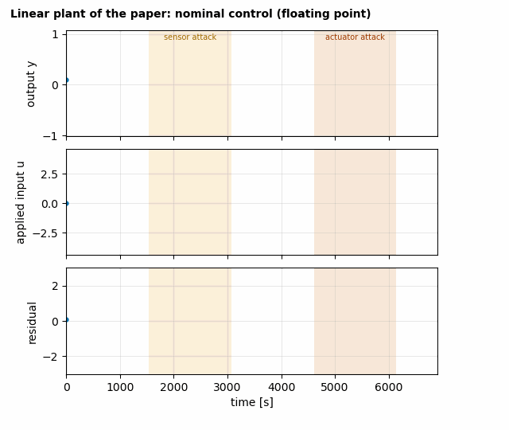
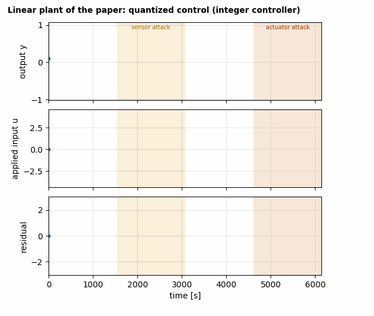
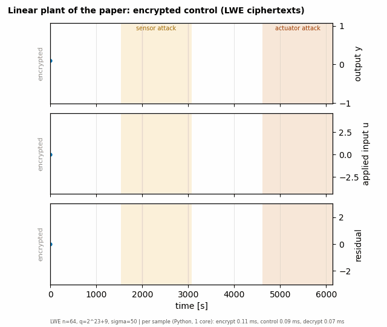
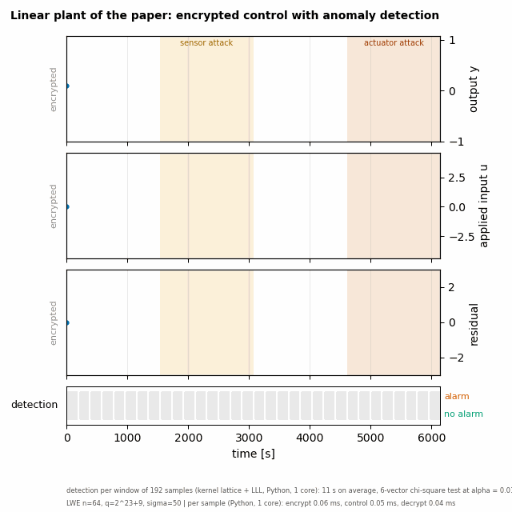
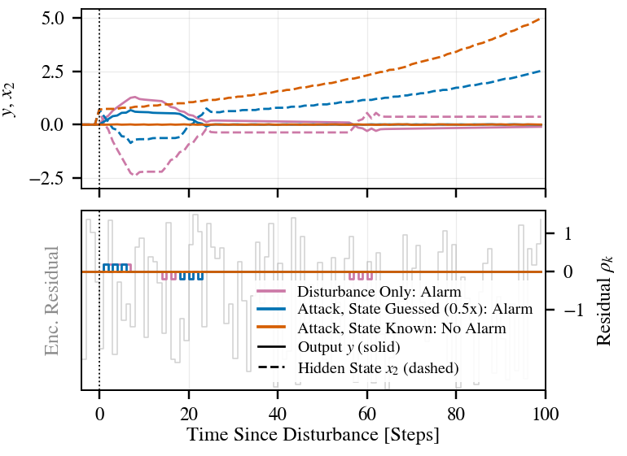

# Anomaly detection with LWE-encrypted control

Reproducible examples for the paper *Anomaly Detection with LWE Encrypted Control* (Alisic, Kim, Sandberg).
A controller that works on LWE ciphertexts, and a detector that, without the secret key, flags attacks on the loop.

<p align="center">
  
</p>

The animation above is the end of a staged simulation: the signals of a nonlinear four-tank process under sensor and
actuator attacks, the encrypted values in the gray background, and the detector's verdict per key epoch filling in
below.

## What is here

| Folder | Content |
|---|---|
| `four_tank/` | staged simulation of two plants (nominal, quantized, encrypted, detected), stealthy-attack study |
| `table1/` | exact Type II errors of the detector's test and of the attacker's test (Table I of the paper) |
| `fig7/` | regenerates the numerical-results figure of the paper from the saved run |

## Quick start

```bash
pip install -r requirements.txt
python table1/type2_table.py                       # Table I (matches the paper within 0.07 percentage points)
cd fig7 && python make_fig7.py 3.5 3.5 out.pdf     # Fig. 7 from windowed_det_data.npz
cd ../four_tank && python make_gifs.py             # the gifs below (needs the saved det_results, ~2 minutes)
```

Re-running the detector (about 2 s per window per plant, needs `blaster-python` or `fpylll`):

```bash
python detect.py linear      # and: python detect.py fourtank      -> det_results/<plant>_compact.npz
```

## The staged simulation

Two plants: the linear plant of the paper (Ts = 1 s) and the nonlinear four-tank process of the KTH lab (Ts = 2 s;
equations and parameters from the lab's MATLAB sources, `h2` controlled by pump 1, linearized around the exact equilibrium).
Each stage adds one thing and has its own script; `experiment.run(plant, mode)` is the single entry point and
`make_gifs.py` draws one gif per stage. All gifs use the same attack storyline (calm start, sensor attack, recovery,
actuator attack, calm end; 36 key epochs of 192 steps, fixed seed) and the same axis limits per plant.

| Stage | Mode | What changes | Script |
|---|---|---|---|
| 1 | `nominal` | floating-point observer-based controller, attack injections | `step1_feedback_attacks.py` |
| 2 | `quantized` | quantized signals and the integer controller of eq. (23) with periodic state reset | `step2_quantization.py` |
| 3 | `encrypted` | the integer controller evaluated on LWE ciphertexts; adds the encrypted measurement, input and residual | `encrypted.py`, `lwe.py` |
| 4 | `detected` | key-less detection per key epoch: kernel lattice of the residual ciphertexts, LLL, 6-vector chi-square test | `detect.py`, `replay.py` |

| | Linear plant | Four-tank process |
|---|---|---|
| 1. nominal |  |  |
| 2. quantized |  |  |
| 3. encrypted |  |  |
| 4. detected |  |  |

In the encrypted gifs the gray background is the second ciphertext component (centered modulo q), as in Fig. 7 of the
paper, and the footer gives the time per sample for encryption, homomorphic control and decryption (about 0.12, 0.09 and
0.07 ms in Python on one core). In the detected gifs a window is gray until its last sample has arrived, yellow while
the detector works on it, and green (no alarm) or red (alarm) afterwards. The plant runs at its sampling rate and
never waits; the detector runs beside it, newest window first, using the measured compute time per window (about
2 s). Window lengths are 192 s (linear) and 384 s (four-tank), so the flags appear about 2 s after each window closes.
`make_gifs.py --time-scale S --workers N` rescales the detector time or the number of detector workers.

### Parameters

| Preset | v | q | sigma | r | Used for |
|---|---|---|---|---|---|
| `COMPACT` | 64 | 2^23 + 9 | 50 | 4096 | all gifs and the stealth study (r chosen for this q) |
| `PAPER` | 64 | 16381 | 26 | 400 | the paper's example; `export_windows.py` and `overnight_detection.py` |

With `COMPACT` there are no decryption failures. With `PAPER` the noise reaching the controller input has standard
deviation about 58 against the limit r/2 = 200, so decryption fails in a few steps of most 6144-step runs; `encrypted.run`
counts them (`dec_errors`). **No security level is claimed for `COMPACT`**; the paper's single 80-bit experiment is the
`PAPER` one. The detector for `PAPER` needs BKZ with sieving (g6k): `export_windows.py` exports the ciphertexts and
`overnight_detection.py` reduces them window by window (resumable); it is provided here and its results are not.

### Harder parameters

`sigma_sweep.py` and `bkz_probe.py` try larger noise. On a four-tank window, sigma = 200 makes LLL miss the attack, and
BKZ-40 recovers it in about 4 s; at sigma = 400 to 1600 (r scaled with sigma) BKZ-50 is no longer enough. These are single-window
probes, not a study.

## Stealthy attacks

`four_tank/STEALTH.md`: a zero-dynamics attack on a plant with a stable or an unstable transmission zero. An attacker who
knows the hidden state keeps the output and the residual at zero, the detector does not alarm, and for an unstable zero
the hidden state grows. With a wrong guess the residual is nonzero and the detector alarms (160 runs, 5 key seeds,
`stealth_sweep.py`).

<p align="center"></p>

## Limits

* The nominal residual is exactly zero because the measurement is quantized with a deadband. Attacks whose effect stays
  inside the deadband are invisible to any residual-based detector, encrypted or not.
* The noise covariance used by the test is computed exactly from the controller (`encrypted.noise_map`).
* The detector times are from one Python process on one core; they show the order of magnitude.
* The Fig. 7 example of the paper used the authors' research code, which depends on g6k; `fig7/` ships the saved
  detector output and the plotting script only.

## License

To be decided by the authors before publication.
