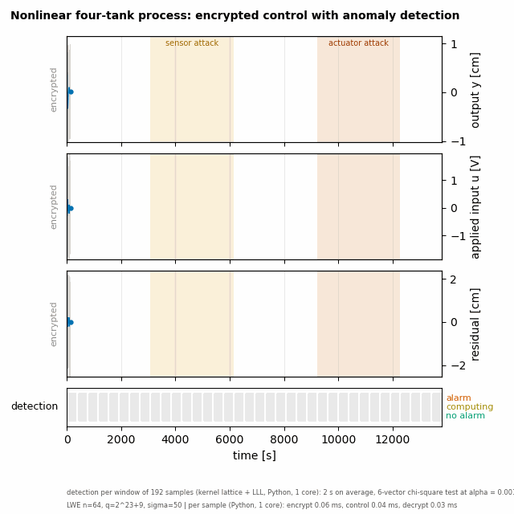
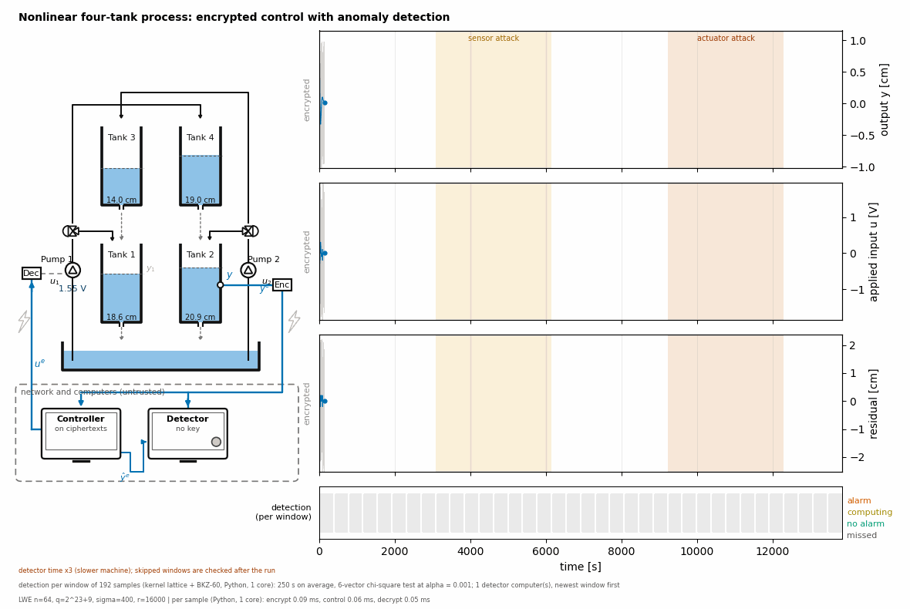
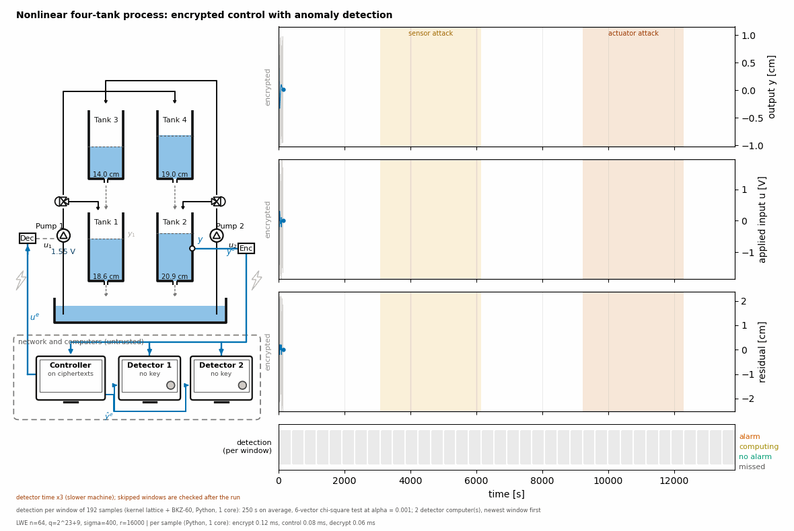
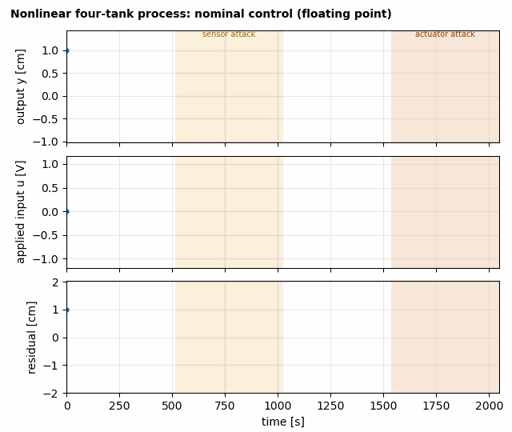
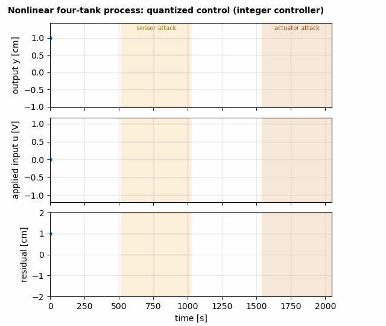
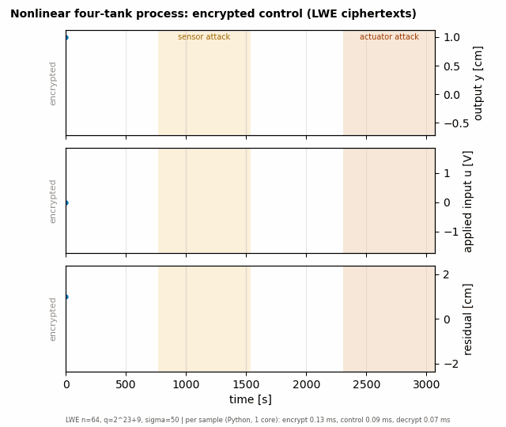

# Anomaly Detection with LWE Encrypted Control

Code for the paper *Anomaly Detection with LWE Encrypted Control* (Alisic, Kim, Sandberg).

## 1. A practical deployment example: the four-tank process

In this example we consider a feedback controller of a four-tank system, but we restrict ourselves to the SISO system where Pump 1
controls the level of Tank 2 (Pump 2 is fixed at steady state).

The system is controlled over homomorphically encrypted signals (using the LWE scheme). The controller uses
$u_k = \hat y_{k-1} - 2y_{k-1}$ (up to scaling), where the output observer is simply $\hat y_k = y_{k-1}$.

We consider a scenario where an attacker (a) injects random noise into the sensor signal, and (b) injects random noise into the
actuator signal.

In gray one can see the encrypted signal, and the signal in blue is the plaintext signal (if no encryption was applied). The two attack
windows are colored in yellow and orange.

The encryption parameters here, $(v, q, \sigma) = (64, 2^{23}+9, 50)$, are weak: the best known attacks cost about $2^{39}$ operations (a
textbook estimate, not a security claim). They are weak enough for the detection to succeed with the polynomial-time LLL algorithm,
and the detector works in roughly real time. However, that also means that an attacker can break the system quickly.

Next we make the noise larger, $\sigma = 400$ ($r$ scaled from 4096 to 16000). LLL is no longer sufficient, and the detector has to rely on
BKZ-60. A window now takes about 250 s to reduce, against a window length of 384 s. On a detector computer three times slower than ours
(stated on the gif), the detector falls behind: it always takes the most recent window, so it misses some windows and the detection
becomes patchy. The gaps are filled in afterwards, but any attack found then happened a long time ago.

However, the detection can be parallelized. The windows are independent, so a second detector computer takes windows in parallel. Each
computer still needs its time per window, but no window is missed.

## 2. The build-up to anomaly detection over LWE

The same attack storyline (calm, sensor attack, calm, actuator attack, calm) in four steps. In the first three the detector works on the
residual and decides at every sample; in the last it works on ciphertexts and decides per window.

| Step | Controller | Detector | Gif |
|---|---|---|---|
| 1 | floating point | residual test at every sample | `fourtank_1_nominal.gif` |
| 2 | integer, quantized signals | residual test at every sample | `fourtank_2_quantized.gif` |
| 3 | the integer controller on LWE ciphertexts | residual test on the decrypted residual, at every sample | `fourtank_3_encrypted.gif` |
| 4 | the same, on ciphertexts | **no key**: lattice reduction of the residual ciphertexts, chi-square test, per window | `fourtank_4_detected.gif` |

  
 

## 3. The figures of the numerical section

| Paper | Command (from the repository root) |
|---|---|
| Table I | `python analysis/type2_table.py` |
| Fig. 7 | `cd fig7 && python make_fig7.py 3.5 3.5 out.pdf` |
| Fig. 8 | `cd four_tank && python compare_fig_columns.py` |
