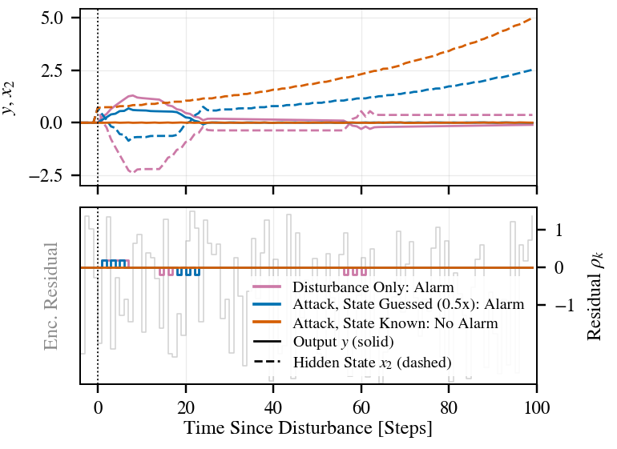

# Stealthy (zero-dynamics) attacks on the encrypted loop

A zero-dynamics attack keeps the output of the closed loop unchanged, so it leaves the residual unchanged and cannot be
detected by any residual-based test, with or without encryption. What matters is what the attacker must know to build it:
the hidden state. This study shows both sides on a plant with a transmission zero.

Files: `zero_attack.py` (plant, controller), `stealth_example.py` (one example, figures), `stealth_sweep.py` (grid, 160
runs), `stealth_fig_paper.py` (the single-column figure), `stealth_table.tex`, `det_results/stealth_*`.

## Plant (discrete time, Ts = 1 s)

The linear plant of the paper with a changed input matrix:

    x+ = A x + B u,  y = C x,   A = [[1.001, 0.4], [0, 0.1]],  C = [1 0],  B = [b1, 0.4722]^T,  b1 = -0.4 * 0.4722 / (z0 - 0.1)

so that the plant has one transmission zero at z0 (the paper's plant has b1 = 0 and no zero). Two cases:

| case | z0 | b1 | consequence of the attack |
|---|---|---|---|
| stable zero | 0.7 | -0.3148 | hidden state decays: undetectable but harmless |
| unstable zero | 1.02 | -0.2053 | hidden state grows: undetectable and harmful |

## Controller

The integer controller of eq. (23) with scale c = 1, reset every kp = 64 steps: a two-tap output feedback on the
quantized output yq = round(5 y),

    U = D yq[k] + a yq[k-1] + b yq[k-2],   u = U / cu,   residual rho = yq[k] - yq[k-1]   (cs = 5, cu = 10)

| case | (D, a, b) | closed-loop spectral radius |
|---|---|---|
| stable zero | (2, 1, 3) | 0.81 |
| unstable zero | (-5, -6, 4) | 0.84 |

These are the integer gains with the smallest spectral radius (unstable) and a low-gain choice with a similar radius
(stable). Feedback cannot move the zeros; the poles of this structure cannot be placed exactly (three gains, four poles).
The residual is the change of the quantized output, so the quantization step (0.2) sets a deadband of 0.1.

## Scenario

Key epochs (detection windows) of 192 steps. At step 196, 4 steps into window 1, a disturbance moves the hidden state to
(0, xi): xi = 3.0 for the stable zero and 0.7 for the unstable one, which gives an output transient of 1.2 to 1.3 in both
(the unstable case is limited by the ciphertext range: r * |U| must stay below q/2).
The attacker injects the actuator input that keeps y at zero, also cancelling the controller's own input,

    u_total = -(A xhat)_1 / b1,   xhat = (x1, g x2):   g = 1 matched (knows the hidden state),  g = 0.5 guesses half.

## Encryption and detection

LWE with the AERO2 parameters (v = 64, q = 2^23 + 9, sigma = 50, r = 4096), integer controller evaluated on ciphertexts,
0 decryption errors in all runs. Detector per window: kernel lattice of the 192 residual ciphertexts, LLL (blaster),
6 shortest vectors, chi-square test at alpha = 0.001.

## Results (5 key seeds per row; the calm window before the disturbance never alarmed in any run)

Alarms in the window where the disturbance and the attack start:

| attacker's guess g | stable zero (xi = 3) | unstable zero (xi = 0.7) | max hidden state, unstable |
|---|---|---|---|
| no attack (disturbance only) | 5/5 | 5/5 | 2.4 |
| 1 (state known) | 0/5 | 0/5 | 28.4 |
| 0.95 | 0/5 | 0/5 | 26.9 |
| 0.9 | 5/5 | 0/5 | 25.6 |
| 0.8 | 5/5 | 0/5 | 22.8 |
| 0.5 | 5/5 | 5/5 | 14.2 |

The window alarms exactly when the attacked output still reaches about 0.1 (half a quantization step) somewhere. With the
state known the output stays below 0.01 and the hidden state of the unstable plant grows to 28 with no alarm. A guess
of half the state leaves a residual and the window alarms. A different kick amplitude moves the threshold in g
(`det_results/stealth_sweep.json` also has xi = 0.7 for the stable and 0.35 for the unstable zero).

Limits: attacks whose effect on the output stays inside the deadband are invisible to any residual-based detector.
Aero2 parameters with LLL are used; the paper's parameters (q = 16381, sigma = 26) need BKZ.
